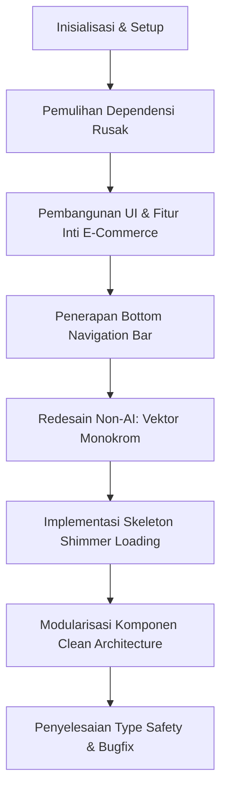

# Dokumentasi Pengembangan & Requirement Aplikasi E-Commerce

Dokumentasi ini mencakup seluruh spesifikasi kebutuhan (*requirements*), arsitektur sistem, alur proses pengembangan (*development lifecycle*), serta panduan pemeliharaan untuk aplikasi mobile E-Commerce berbasis **React Native** dan **Expo**.

---

## 1. Spesifikasi Kebutuhan (*Requirements*)

### 1.1 Kebutuhan Lingkungan (*Environment Requirements*)
- **Node.js**: Versi `^22.13.0` atau `^24.x` (LTS direkomendasikan).
- **Package Manager**: npm versi `10.x` / `11.x`.
- **Platform Target**:
  - **Android**: Android 9.0 (Pie) ke atas via **Expo Go** atau APK build.
  - **iOS**: iOS 14.0 ke atas via **Expo Go** atau TestFlight.
  - **Web**: Mendukung browser modern (Chrome, Safari, Edge, Firefox).
- **TypeScript**: Versi `~6.0.3` (Mode Strict).

### 1.2 Daftar Dependensi (*Dependencies*)
Berdasarkan file `package.json`:

| Paket | Versi | Fungsi |
| :--- | :--- | :--- |
| **`expo`** | `~58.0.19` | Core framework universal native app |
| **`react`** | `19.3.0` | UI Library inti |
| **`react-native`** | `0.88.0` | Native runtime & komponen mobile dasar |
| **`@expo/vector-icons`** | `^14.0.0` | Ikon vektor industri (`Ionicons`, `Feather`, `MaterialCommunityIcons`) |
| **`expo-status-bar`** | `~58.0.4` | Pengaturan bar status perangkat yang konsisten lintas platform |
| **`typescript`** | `~6.0.3` | Pengecekan tipe statis (*type safety*) |
| **`@types/react`** | `~19.3.0` | Definisi tipe TypeScript untuk React 19 |

---

## 2. Arsitektur Proyek (*Clean Architecture Pattern*)

Proyek ini telah direfaktor dari satu file monolitik menjadi struktur modular berbasis pemisahan tanggung jawab (*Separation of Concerns*):

```text
ecommerce-app/
├── App.tsx                          # Root Controller & State Manager (~210 baris)
├── DOCUMENTATION.md                 # Dokumentasi proses dan requirement aplikasi
├── package.json                     # Konfigurasi dependensi proyek
├── tsconfig.json                    # Konfigurasi TypeScript compiler
└── src/
    ├── types/
    │   └── index.ts                 # Kontrak antarmuka data (Product, CartItem, TabType, Category)
    ├── data/
    │   └── mockData.ts              # Data katalog e-commerce realistis & fungsi helper (formatRupiah)
    ├── components/
    │   ├── common/
    │   │   ├── TopAppBar.tsx        # Header utama (Alamat pengiriman, search, notifikasi, badge keranjang)
    │   │   ├── BottomNav.tsx        # Bottom Navigation Bar 5-tab dengan badge numerik
    │   │   ├── ToastNotification.tsx# Toast feedback visual saat aksi berhasil
    │   │   └── Skeleton.tsx         # Animasi Shimmer Pulsa 60fps (SkeletonBlock & SkeletonProductCard)
    │   ├── home/
    │   │   ├── PromoBanner.tsx      # Banner promosi payday dengan CTA
    │   │   ├── QuickServices.tsx    # 4 Tombol layanan cepat monokrom (Official, Flash Sale, Ongkir, Kupon)
    │   │   └── CategoryChips.tsx    # Filter kategori horizontal interaktif
    │   ├── product/
    │   │   ├── ProductCard.tsx      # Kartu produk standar industri (foto, harga, diskon, rating, wishlist)
    │   │   ├── ProductGrid.tsx      # Grid 2-kolom produk dengan fallback skeleton & empty state
    │   └── product/
    │       └── ProductDetailModal.tsx # Bottom-sheet modal detail produk & jaminan garansi
    │   └── cart/
    │       └── CartItemRow.tsx      # Baris produk keranjang (Checkbox, counter qty +/-, hapus)
    └── screens/
        ├── HomeScreen.tsx           # Layar Beranda utama dengan Pull-to-Refresh
        ├── CatalogScreen.tsx        # Layar Katalog & eksplorasi pencarian produk
        ├── WishlistScreen.tsx       # Layar Barang Disimpan (Wishlist)
        ├── CartScreen.tsx           # Layar Keranjang Belanja & Bottom Checkout Sheet
        └── ProfileScreen.tsx        # Layar Akun Pengguna, pelacak status pesanan, & pengaturan
```

---

## 3. Dokumentasi Proses Pengembangan (*Development Process*)

Pengembangan dilakukan melalui tahapan iteratif terstruktur berikut:



### Tahap 1: Diagnosa & Perbaikan Kerusakan Dependensi Awal
- **Kendala**: Perintah `npx expo start` awal mengalami kegagalan beruntun (`Cannot find module 'has-flag'`, `'resolve-from'`, `'lodash.throttle'`, `'nullthrows'`).
- **Analisis**: Terjadi interupsi/korupsi pada cache lokal npm di sistem operasi Windows, menyebabkan npm hanya mengekstrak `package.json` tanpa mengekstrak file kode `.js` utama.
- **Penyelesaian**:
  1. Membersihkan cache secara paksa: `npm cache clean --force`.
  2. Menghapus folder `node_modules` korup dan `package-lock.json`.
  3. Menjalankan instalasi ulang bersih: `npm install` (460 paket berhasil terpasang lengkap).

### Tahap 2: Pembangunan Antarmuka & Logika Inti
- Menyusun alur e-commerce interaktif:
  - Katalog barang realistis (Gadget, Smartwatch, Sepatu Sneakers, Apparel).
  - Sistem pencarian langsung (*real-time filter*).
  - Manajemen keranjang (*Add to Cart*, kuantitas bertingkat, hapus barang).
  - Sistem penanda favorit (*Wishlist Toggle*).
  - Bottom sheet modal detail produk lengkap dengan deskripsi dan jaminan keaslian.

### Tahap 3: Penambahan Bottom Navigation Bar
- Menyematkan bilah navigasi bawah 5 tab:
  - **Beranda** (Home)
  - **Katalog** (Catalog)
  - **Wishlist** (Favorit) dengan badge jumlah barang disukai
  - **Keranjang** (Cart) dengan badge jumlah barang belanjaan
  - **Akun** (Profile)

### Tahap 4: Redesain Anti "AI-Look" (Monokromatis & Otentik)
- **Eliminasi Emoji**: Menghapus seluruh emoji generik pada ikon antarmuka dan menggantinya dengan paket vektor standar industri `@expo/vector-icons`.
- **Monokrom Cohesive Palette**: Mengganti ikon warna-warni pelangi (biru, oranye, hijau, ungu) pada *Quick Services* menjadi satu palet monokrom minimalis modern (*Charcoal/Slate* `#0F172A` di atas `#F8FAFC`).
- **Microcopy Realistis**:
  - Alamat pengiriman dinamis (*"Dikirim ke Rumah - Jakarta Selatan"*)
  - Badge *"OFFICIAL"*
  - Metrik ulasan nyata (*"★ 4.9 • Terjual 1.2rb"*)
  - Lokasi asal toko (*Jakarta Pusat, Bandung, Tangerang, Surabaya*).

### Tahap 5: Implementasi Skeleton Loading (Shimmer Pulsa 60 FPS)
- Membangun komponen `SkeletonBlock` menggunakan API animasi bawaan React Native `Animated.loop(Animated.sequence([...]))`.
- Membuat `SkeletonProductCard` yang memetakan persis posisi balok foto, judul dua baris, harga, rating, dan tombol aksi.
- Mengintegrasikan `RefreshControl` (*Pull-to-Refresh*) pada layar Beranda dan Katalog untuk memicu animasi skeleton secara natural.

### Tahap 6: Modularisasi Kode (Pola Desain Terpisah)
- Memecah monolit `App.tsx` (~2.000 baris) menjadi:
  - 1 file root controller
  - 4 komponen umum (*common*)
  - 3 komponen beranda (*home*)
  - 3 komponen produk (*product*)
  - 1 komponen keranjang (*cart*)
  - 5 layar penuh terpisah (*screens*)
- Hasil: Kode menjadi sangat mudah dibaca, mudah diuji (*testable*), dan siap untuk integrasi API backend / state manager (Redux/Zustand).

### Tahap 7: Bugfix & Optimasi TypeScript Strict
- Mengatasi peringatan squiggly line pada `StatusBar` dengan memisahkan penggunaan visual `<StatusBar style="dark" />` dari `expo-status-bar` dan pembacaan nilai tinggi numerik Android `RNStatusBar.currentHeight` dari `react-native`.

---

## 4. Panduan Menjalankan & Memelihara Aplikasi

### 4.1 Menjalankan Dev Server
Buka terminal di folder `d:\BELAJAR REACT NATIVE\ecommerce-app`:

```powershell
npx expo start
```

### 4.2 Navigasi Pengujian
- **HP Fisik**: Buka aplikasi **Expo Go** (Android/iOS) lalu scan QR code yang tampil di terminal.
- **Android Emulator**: Tekan huruf **`a`** di terminal.
- **Web Browser**: Tekan huruf **`w`** di terminal.
- **Uji Skeleton**: Tarik layar ke bawah (*pull to refresh*) di halaman Beranda atau pilih filter kategori.
- **Uji Transaksi**: Masukkan produk ke keranjang, masuk ke tab Keranjang, centang item, dan tekan tombol **Beli Sekarang**.
